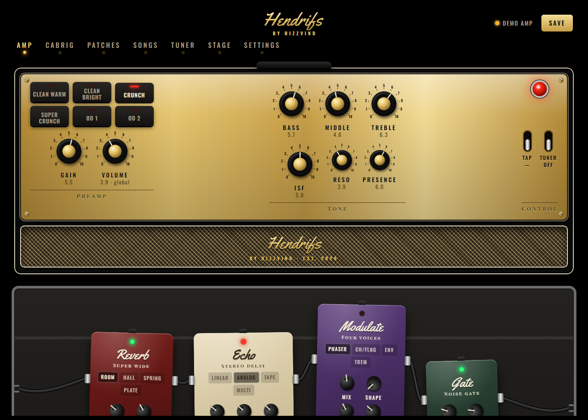
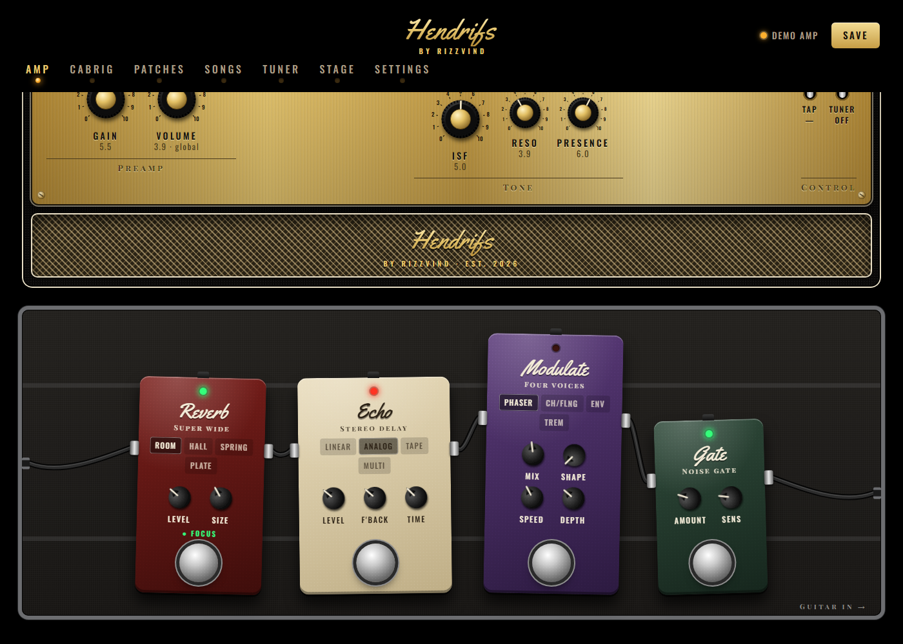
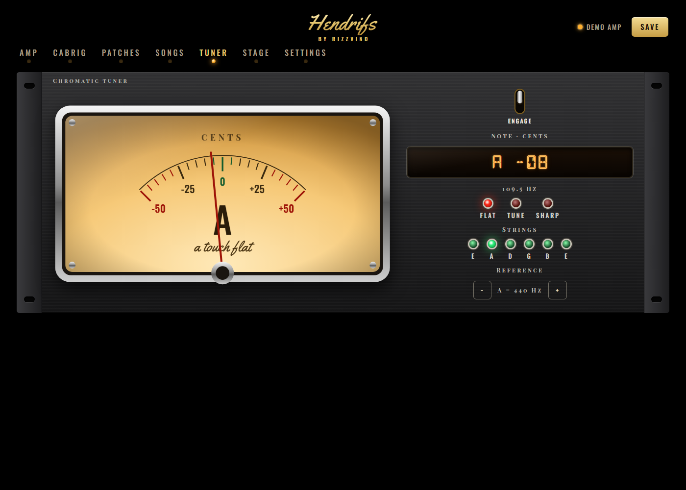
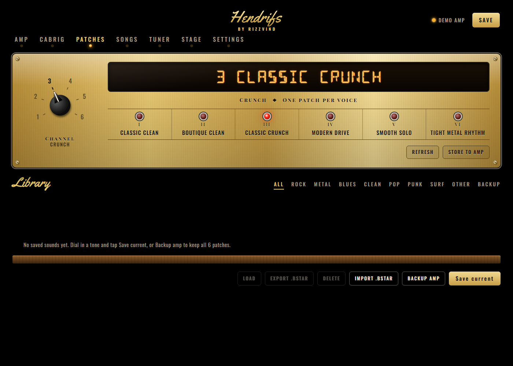
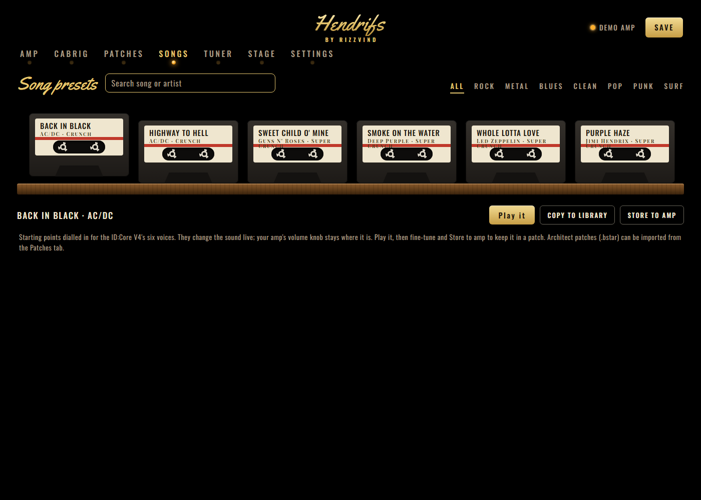
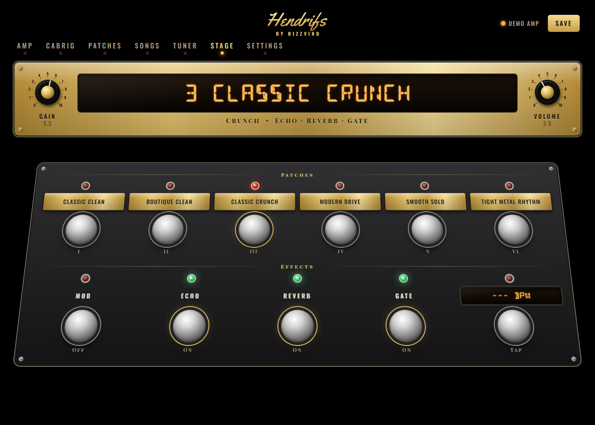
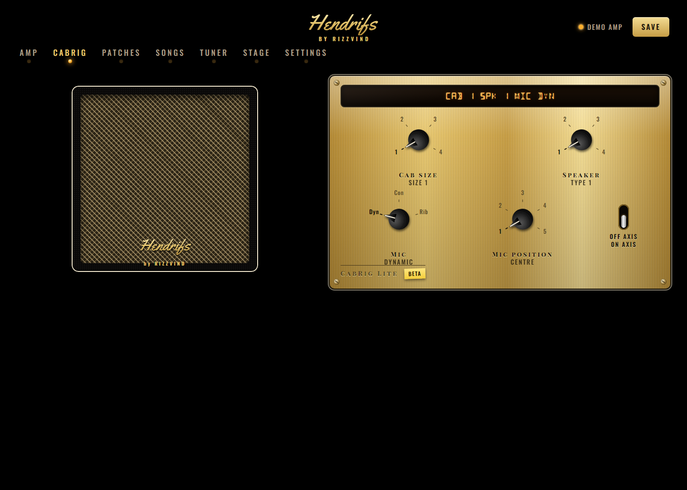
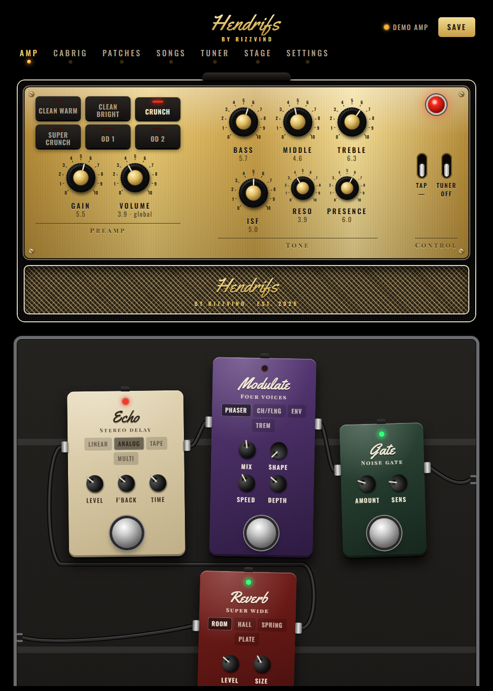

# Hendrifs
by Rizzvind

Control your Blackstar ID:Core V4 straight from an Android tablet or phone, no PC needed.
Plug in with a USB-C cable and get the amp, effects, patches, tuner and CabRig on a vintage gold amp-head screen.

> Not affiliated with or endorsed by Blackstar Amplification. "Blackstar" and "ID:Core" are their trademarks.

## Screenshots
Shown in the built-in demo mode at OnePlus Pad size (1400 × 1000).



| Pedalboard | Tuner |
|---|---|
|  |  |
| **Patches** | **Song presets** |
|  |  |
| **Stage** | **CabRig** |
|  |  |

<p align="center"></p>

## What it does
- **Amp:** voice, gain, volume, bass, middle, treble, ISF, resonance, presence.
- **Pedalboard:** modulation, delay and reverb with types and all their knobs, the amp's own on / focus / off switching, tap tempo, noise gate (amount and sensitivity, stored per patch).
- **Patches:** the amp's 6 patches, store to the amp (behind a write-protect switch, read back and checked), and a library on the device with backup and restore of all 6.
- **Song presets:** 45 song tones made for the V4 (search by song or artist, by genre). Play one live, copy it to the library, or store it to its voice's patch.
- **Architect patches:** import `.bstar` files (Patches → Import, or "Open with Hendrifs" from a file manager or chat app) and export library sounds as `.bstar`.
- **Tuner:** opening the Tuner tab puts the amp in tuner mode (output muted, like holding REV). The phone listens to the guitar through the amp's USB audio for a precise chromatic needle; without microphone permission it uses the amp's own readings.
- **CabRig and settings:** cabinet, mic and routing options, footswitch modes.
- **Stage:** big footswitch-style buttons for playing live.
- **Demo amp:** try every screen without the amp.
- **USB log:** Settings → Service shows and shares every packet, for debugging.

Status: the USB protocol was captured from a real ID:Core Stereo 10 V4 (firmware 1.0.4) and Blackstar Architect 2.1.1; see `research/V4-PROTOCOL.md`.
Knobs, effects, noise gate, patch select / read / store, whole-sound loading and the tuner are confirmed on the amp.
Items marked **Beta** (CabRig, footswitch, super wide stereo) use the same confirmed command pattern but were not tried one by one.

## Requirements
- Android 8.0 or newer, with USB host (OTG) support.
- A USB-C data cable from the amp to the device. Some phones (OnePlus, Oppo, Realme) need OTG switched on in Settings.

## Build
```
cd app
./gradlew testDebugUnitTest assembleRelease
```
Needs JDK 17+ and the Android SDK (platform 36). The APK lands in Gradle's build folder under `outputs/apk/release/`.

## How it is put together
- `app/app/src/main/assets/www/index.html`: the whole interface, shown full screen in a WebView. Open it in a desktop browser with `#demo` to preview without a device.
- `MainActivity.kt`: hosts the page and bridges it to the amp (`HendrifsNative.send(json)` in, `PT.onState(...)` out).
- `AmpController.kt`: one worker thread for all USB reads and writes. Knob moves are coalesced, and the amp's echoes of our own commands are ignored.
- `TunerAudio.kt`: YIN pitch detection on the amp's USB audio. `BstarFormat.kt`: Architect patch files. `assets/presets/songs.json`: song presets.
- `protocol/IdCoreProtocol.kt`: the 64-byte HID packet format, with unit tests.
- `usb/UsbHidTransport.kt`: claims only the amp's HID interface, so its USB audio keeps working.
- `research/`: notes on the protocol and on the V4 firmware.
- The `*.html` files in the root are design explorations.

## Fonts
Oswald, Playfair Display SC, Yellowtail, Fraunces and Damion (SIL Open Font License) and DSEG14 (SIL OFL), bundled so the app works offline.
